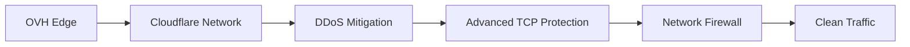
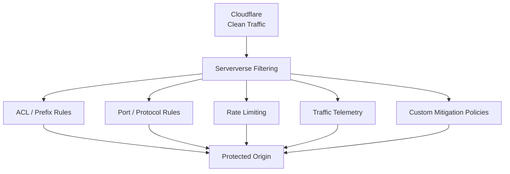
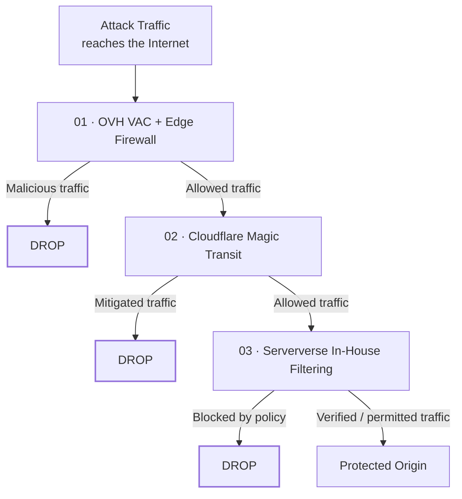
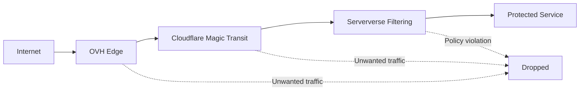

# 01 · OVH VAC + Edge Firewall

The first layer is positioned at the **OVH network edge**.

OVH's Anti-DDoS infrastructure and Edge Network Firewall provide the first network-level filtering boundary before traffic reaches the Serververse infrastructure.

This layer is primarily responsible for handling unwanted traffic as early in the path as possible.

### What happens here?

```text
Incoming Traffic
       │
       ▼
┌─────────────────────────┐
│      OVH Network Edge   │
│                         │
│  Anti-DDoS / VAC        │
│  Edge Network Firewall  │
└────────────┬────────────┘
             │
       ┌─────┴─────┐
       │           │
    Filtered     Allowed
     Traffic     Traffic
       │           │
       ▼           ▼
      DROP     Next Layer
```

The OVH layer can provide:

- Network-level DDoS mitigation
- Edge firewall policies
- Stateless traffic filtering
- Early traffic rejection
- Protection before traffic reaches the origin network

### Why the first layer matters

The earlier unwanted traffic can be discarded, the less of that traffic needs to be processed by the layers behind it.

This makes the upstream edge an important part of the overall mitigation chain.

---

# 02 · Cloudflare Magic Transit

Traffic that passes the first layer enters the second security boundary through **Cloudflare Magic Transit**.

Magic Transit provides network-layer protection for routed IP prefixes using Cloudflare's global network.

Traffic can be inspected and filtered across Cloudflare's network before clean traffic is returned toward the Serververse infrastructure.



Cloudflare's network provides an additional globally distributed mitigation layer between the public Internet and the protected infrastructure.

### This layer can provide

- DDoS mitigation
- Network firewall policies
- TCP protection
- Traffic filtering
- Globally distributed traffic processing
- BGP-based traffic routing through the Cloudflare network

### Why add another layer?

A single upstream provider does not need to be the only filtering boundary.

With Magic Transit in the path, traffic receives another opportunity to be identified and filtered before it reaches the Serververse network.

---

# 03 · Serververse In-House Filtering

After upstream mitigation, traffic enters the **Serververse network**.

This is the final filtering layer immediately before the protected infrastructure.

Unlike upstream mitigation systems, this layer is controlled by Serververse and can apply policies specific to the protected network and workload.



### Serververse filtering can include

- Custom ACLs
- IP and prefix filtering
- Port-based filtering
- Protocol-based policies
- Rate limiting
- Connection controls
- Traffic telemetry
- Custom mitigation rules
- Infrastructure-specific policies

This gives Serververse direct control over the final network boundary before traffic reaches the workload.

---

# What Happens During an Attack?

Shield is designed around **progressive filtering**.

When an attack occurs, traffic moves through the same layered architecture, with each layer providing an additional opportunity to discard unwanted traffic.



The important concept is simple:

> **Traffic must pass multiple filtering boundaries before it reaches the origin.**

---

# Attack Traffic vs Clean Traffic

The architecture can be visualized as a progressive filtering pipeline:

```text
                         INTERNET
                            │
                            │
              ┌─────────────▼─────────────┐
              │     01 · OVH EDGE         │
              │                           │
              │   VAC + Edge Firewall     │
              └─────────────┬─────────────┘
                            │
                     Filtered Traffic
                            │
              ┌─────────────▼─────────────┐
              │    02 · CLOUDFLARE        │
              │                           │
              │     Magic Transit         │
              └─────────────┬─────────────┘
                            │
                       Clean Traffic
                            │
              ┌─────────────▼─────────────┐
              │   03 · SERVERVERSE        │
              │                           │
              │   In-House Filtering      │
              └─────────────┬─────────────┘
                            │
                     Verified Traffic
                            │
                    ┌───────▼───────┐
                    │    ORIGIN     │
                    │               │
                    │ Game / VPS /  │
                    │ Web / API     │
                    └───────────────┘
```

Each stage reduces the amount of unwanted traffic that continues toward the protected workload.

---

# Defense in Depth

The main principle behind Shield is **defense in depth**.

Rather than depending on a single mitigation system, Shield places multiple security boundaries between the Internet and your infrastructure.

| Layer | Infrastructure | Primary Role |
| --- | --- | --- |
| **01** | OVH VAC + Edge Firewall | Upstream network filtering and DDoS mitigation |
| **02** | Cloudflare Magic Transit | Globally distributed DDoS mitigation and network filtering |
| **03** | Serververse Filtering | Infrastructure-specific policies and final filtering |
| **04** | Protected Origin | Your actual workload |

Each layer operates at a different point in the traffic path.

---

# Why Three Layers?

## 1. Multiple security boundaries

If unwanted traffic passes one filtering layer, it still has to pass the next layer before reaching the origin.

## 2. Earlier traffic rejection

Traffic can be discarded upstream instead of consuming resources at the protected workload.

## 3. Global mitigation

Cloudflare provides a globally distributed network layer between the public Internet and Serververse infrastructure.

## 4. Serververse-controlled policies

The final filtering layer allows Serververse to apply policies specific to the protected infrastructure.

## 5. Better visibility

Traffic reaching the Serververse network can be observed through our own network telemetry and monitoring systems.

---

# Clean Traffic Delivery

The objective of Shield is not to block legitimate users.

The objective is to **remove unwanted traffic while allowing legitimate traffic to continue toward the protected service**.



Legitimate traffic continues through the chain:

```text
Internet
   ↓
OVH
   ↓
Cloudflare
   ↓
Serververse
   ↓
Protected Service
```

---

# Traffic Is Not Automatically Trusted

Passing an upstream mitigation provider does not automatically make traffic trusted.

Shield follows a layered approach:

```text
                    ┌──────────────────────┐
                    │      INTERNET        │
                    └──────────┬───────────┘
                               │
                               ▼
                    ┌──────────────────────┐
                    │    OVH EDGE LAYER    │
                    └──────────┬───────────┘
                               │
                         First Filter
                               │
                               ▼
                    ┌──────────────────────┐
                    │ CLOUDFLARE MAGIC     │
                    │       TRANSIT        │
                    └──────────┬───────────┘
                               │
                        Second Filter
                               │
                               ▼
                    ┌──────────────────────┐
                    │ SERVERVERSE NETWORK  │
                    │      FILTERING       │
                    └──────────┬───────────┘
                               │
                        Final Filter
                               │
                               ▼
                    ┌──────────────────────┐
                    │   PROTECTED ORIGIN   │
                    └──────────────────────┘
```

This is the core idea behind Serververse Shield:

> **Three filtering layers. One protected origin.**

---

# What Shield Protects

Shield can be deployed in front of infrastructure such as:

- Minecraft and game servers
- VPS infrastructure
- Web applications
- APIs
- Dedicated servers
- Network services
- Public IP infrastructure

The exact mitigation capabilities and routing behaviour depend on the protected service and network configuration.

---

# Built for Network-Level Attacks

Shield is designed around network-level protection rather than relying only on application-level proxies.

This allows the architecture to protect services that require direct IP connectivity and protocols beyond traditional HTTP traffic.

Examples include:

```text
L3  · Network traffic
L4  · TCP / UDP traffic
     ↓
Network filtering
     ↓
Protected infrastructure
```

For application-specific attacks, additional application-layer controls may be required depending on the workload.

---

# The Shield Pipeline

The entire architecture can be summarized in one flow:

```text
┌─────────────────────────────────────────────────────────────┐
│                         INTERNET                            │
└────────────────────────────┬────────────────────────────────┘
                             │
                             ▼
┌─────────────────────────────────────────────────────────────┐
│                  01 · OVH NETWORK EDGE                     │
│                                                             │
│              VAC + Edge Network Firewall                   │
│                                                             │
│             First network filtering layer                  │
└────────────────────────────┬────────────────────────────────┘
                             │
                             ▼
┌─────────────────────────────────────────────────────────────┐
│                    02 · CLOUDFLARE                          │
│                                                             │
│                    Magic Transit                           │
│                                                             │
│        Global DDoS mitigation + network filtering           │
└────────────────────────────┬────────────────────────────────┘
                             │
                             ▼
┌─────────────────────────────────────────────────────────────┐
│                   03 · SERVERVERSE                         │
│                                                             │
│                  In-House Filtering                         │
│                                                             │
│       ACLs · Policies · Rate Limits · Telemetry              │
└────────────────────────────┬────────────────────────────────┘
                             │
                             ▼
┌─────────────────────────────────────────────────────────────┐
│                     PROTECTED ORIGIN                        │
│                                                             │
│          Game · VPS · Web · API · Network Service           │
└─────────────────────────────────────────────────────────────┘
```

## One Origin. Three Filtering Layers.

Serververse Shield combines upstream network protection, globally distributed mitigation and Serververse-controlled filtering into a single layered architecture.

**Internet → OVH → Cloudflare → Serververse → Origin**

That is how Shield keeps unwanted traffic away from the infrastructure that matters.
